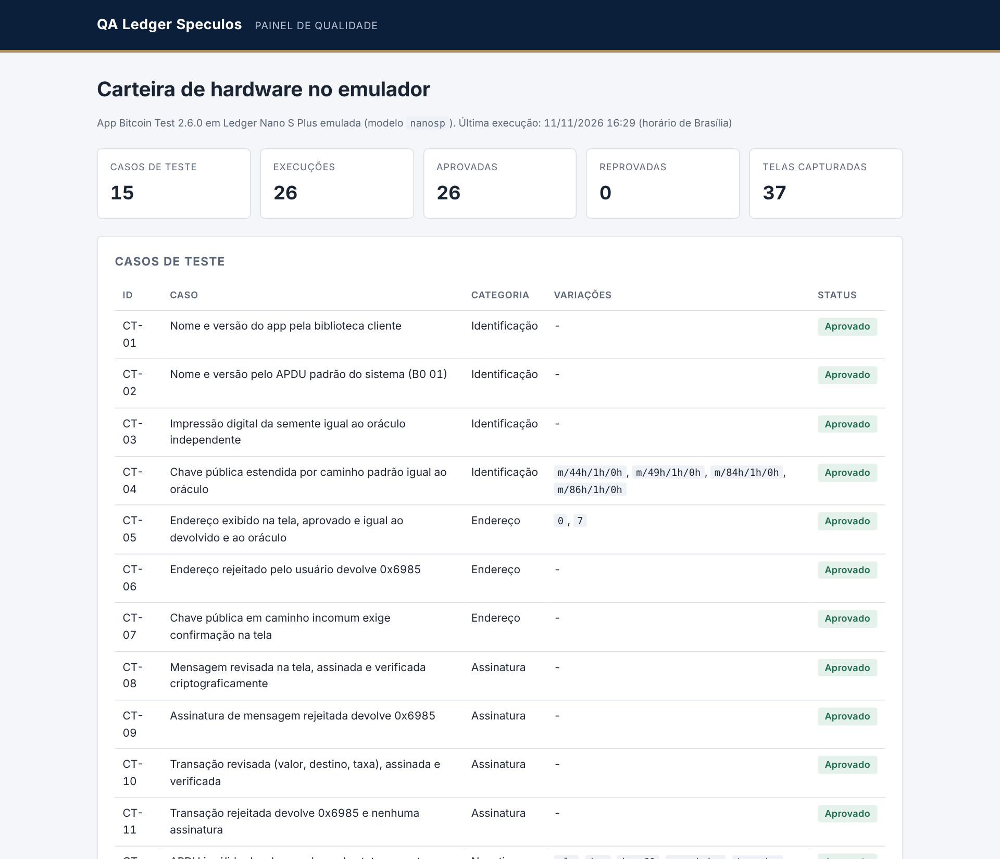
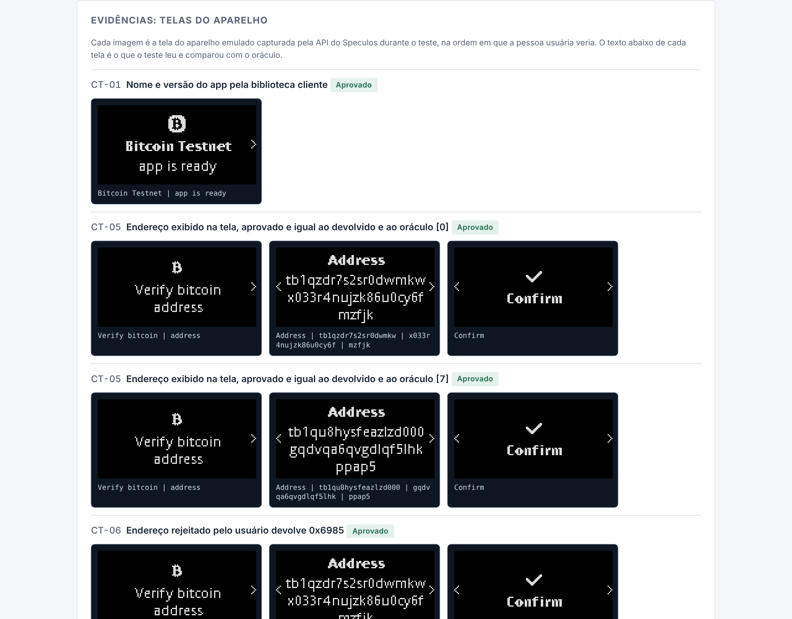

# QA Ledger Speculos

[](https://github.com/pamteech/qa-ledger-speculos/actions/workflows/testes-ledger.yml)
[](https://pamteech.github.io/qa-ledger-speculos/)


Suíte de testes automatizados de uma carteira de hardware **Ledger Nano S Plus** rodando no emulador oficial **Speculos**, com o app **Bitcoin Test 2.6.0**. Os testes conversam com o app por APDU, leem a tela do aparelho pela API REST do Speculos, apertam os botões como uma pessoa faria e conferem cada resultado com um oráculo criptográfico independente.

**Relatório ao vivo:** https://pamteech.github.io/qa-ledger-speculos/



## Objetivo

Validar os fluxos que mais importam numa carteira de hardware:

- o app se identifica corretamente e deriva as chaves certas;
- **o endereço que aparece na tela é exatamente o endereço que o app devolve ao computador**;
- nada é assinado sem aprovação no aparelho, e a rejeição devolve o código de erro correto;
- a tela de revisão mostra valor, destino e taxa corretos antes de assinar;
- as assinaturas produzidas são válidas criptograficamente;
- entradas inválidas são recusadas com a palavra de status certa e o app continua funcionando.

## Por que isso importa

Uma carteira de hardware existe para que a pessoa confie **na tela do aparelho**, não na tela do computador. O defeito mais grave possível é o aparelho mostrar uma coisa e assinar outra. Testar isso num aparelho físico é lento, manual e arriscado. O Speculos executa o mesmo binário do app num ARM emulado, expõe a tela e os botões por API e permite automatizar esses fluxos com segurança:

- sem aparelho físico e sem semente real;
- sem tocar a rede Bitcoin (a transação assinada usa uma entrada fictícia e nunca é transmitida);
- de forma repetível na integração contínua, com evidência de cada tela.

> **Semente apenas de teste.** Todas as chaves vêm da semente padrão do Speculos (`glory promote mansion ...`), que é pública e está no código do próprio emulador. Ela serve só para testes. Nunca use essa semente em carteira real e nunca envie fundos para os endereços que aparecem aqui.

## Como funciona

```
pytest ──APDU (TCP 9999)──> Speculos (Nano S Plus emulada) ──> app Bitcoin Test 2.6.0
   │                              │
   └──REST (5000): /events, /button, /screenshot
   │
   └──oráculo independente (embit): deriva chaves e endereços da semente de teste,
      calcula o sighash e verifica as assinaturas
```

- **Tela:** `GET /events?currentscreenonly=true` devolve o texto da tela atual; `GET /screenshot` devolve a imagem PNG, salva como evidência.
- **Botões:** `POST /button/right` avança, `POST /button/both` confirma a opção da tela.
- **APDU:** comandos de alto nível pela biblioteca oficial `ledger_bitcoin` e APDUs crus pelo mesmo canal TCP.
- **Oráculo:** a biblioteca `embit` calcula de forma independente impressão digital, xpub, endereço e o hash assinado. Se app e oráculo concordam, o resultado está correto.

## Casos de teste

| ID | Caso | Categoria | Oráculo |
|---|---|---|---|
| CT-01 | Nome e versão do app pela biblioteca cliente | Identificação | `Bitcoin Test` e `2.6.0` |
| CT-02 | Nome e versão pelo APDU padrão do sistema (`B0 01`) | Identificação | resposta decodificada e status `9000` |
| CT-03 | Impressão digital da semente | Identificação | igual ao oráculo (`f5acc2fd`) |
| CT-04 | xpub dos caminhos padrão BIP-44, 49, 84 e 86 (4 variações) | Identificação | igual ao oráculo |
| CT-05 | Endereço exibido na tela e aprovado (índices 0 e 7) | Endereço | texto da tela = endereço devolvido = oráculo |
| CT-06 | Endereço rejeitado pelo usuário | Endereço | status `6985` e nenhum endereço devolvido |
| CT-07 | xpub em caminho incomum exige confirmação na tela | Endereço | caminho e xpub da tela = oráculo |
| CT-08 | Mensagem revisada na tela, assinada e verificada | Assinatura | caminho e mensagem na tela; assinatura BIP-137 válida; inválida para outra mensagem ou outra chave |
| CT-09 | Assinatura de mensagem rejeitada | Assinatura | status `6985` |
| CT-10 | Transação revisada e assinada | Assinatura | valor, destino e taxa na tela; troco não exibido; assinatura ECDSA válida sobre o sighash BIP-143 |
| CT-11 | Transação rejeitada | Assinatura | status `6985` e nenhuma assinatura |
| CT-12 | APDU inválido (5 variações) | Negativo | `6E00` para CLA, `6D00` para INS, `6A87` para tamanho de dados |
| CT-13 | Caminho fora do padrão sem confirmação (3 variações) | Negativo | status `6A82` |
| CT-14 | Caminho da rede principal no app de testnet, com e sem tela | Negativo | status `6A82` e nada exibido |
| CT-15 | App continua respondendo após erros | Negativo | comandos válidos funcionam em seguida |

São **15 casos** e **26 execuções** contando as variações parametrizadas. Todos os testes que envolvem tela salvam a sequência de telas em PNG, visível no relatório.

## Como rodar localmente

Requisitos: Python 3.12 ou superior e Docker.

```bash
python -m venv .venv && . .venv/bin/activate
pip install -r requirements.txt
./scripts/subir-speculos.sh          # sobe o Speculos em Docker nas portas 5000 e 9999
python -m pytest --timeout 90 --html=reports/pytest/index.html --self-contained-html
python scripts/montar_painel.py      # gera reports/index.html
docker rm -f speculos                # desliga o emulador
```

Sem Docker, instale o emulador como pacote Python (`pip install speculos==0.27.4`) e tenha `qemu-arm-static` no sistema; o script usa esse modo com `SPECULOS_MODO=local`. Para acompanhar a tela ao vivo, abra http://127.0.0.1:5000 no navegador enquanto os testes rodam.

## Ambiente

| Item | Versão |
|---|---|
| Emulador | `ghcr.io/ledgerhq/speculos`, imagem `latest` publicada pela Ledger, fixada pelo digest `sha256:56c7ec84...` (consultado em 11/11/2026) |
| Modelo emulado | Nano S Plus (`--model nanosp`) |
| App | Bitcoin Test 2.6.0, SDK v27.1.7. Origem e SHA-256 em [`apps/nanosp/ORIGEM.md`](apps/nanosp/ORIGEM.md) |
| Cliente | `ledger_bitcoin` 0.4.2 (biblioteca oficial da Ledger) |
| Oráculo | `embit` 0.8.0 |
| Testes | pytest 9, pytest-html 4, pytest-timeout |

O binário do app é o artefato oficial de CI do repositório [LedgerHQ/app-bitcoin-new](https://github.com/LedgerHQ/app-bitcoin-new), licença Apache-2.0, sem modificação. A CI confere o SHA-256 antes de rodar.

## Integração contínua

O workflow [`testes-ledger.yml`](.github/workflows/testes-ledger.yml) roda em `ubuntu-24.04` a cada push, em pull requests e toda segunda-feira às 08:00 (horário de Brasília). Ele confere a integridade do app, sobe o Speculos em Docker, executa o pytest, monta o painel com as telas, publica no GitHub Pages e só então reprova o job se algum teste falhou. Assim o relatório fica disponível mesmo quando um teste quebra.

## Achados

Observações reais feitas durante a construção da suíte:

- **O Speculos repassa toda resposta de APDU ao cliente TCP conectado, mesmo quando o comando foi enviado pela API REST (`POST /apdu`).** Na primeira execução, um APDU de versão enviado por REST teve a resposta entregue também ao cliente TCP, e o teste seguinte recebeu os bytes de `Bitcoin Test 2.6.0` no lugar da impressão digital. O comportamento está no código do emulador (`speculos/mcu/apdu.py`, `forward_to_client`). A suíte passou a usar um único canal (TCP) para todos os APDUs.
- **O app recusa caminhos fora do padrão sem confirmação (`6A82`), mas aceita o mesmo caminho quando a pessoa confirma na tela.** Para `m/84'/1'/1000'` com exibição, o Nano S Plus mostra "Confirm public key", o caminho e a chave em três páginas, sem uma tela de aviso específica de caminho incomum. A decisão fica com a pessoa, que vê o caminho completo.
- **O app de testnet recusa o caminho da rede principal (`m/44'/0'/0'`) mesmo com exibição na tela**, com `6A82` e sem mostrar nada. É uma proteção útil contra confundir rede de teste e rede principal.
- **O comando de impressão digital (`E1 05`) ignora P1 e P2.** `E1 05 01 00` e `E1 05 00 01` respondem `9000` com a impressão digital, em vez de recusar parâmetros não usados. Impacto baixo, porque a impressão digital não é sensível, mas fica registrado.
- **Um caminho com 10 níveis abaixo de `m/84'/1'/0'` é aceito sem confirmação na tela.** Observado de forma exploratória com `m/84'/1'/0'/0/0/0/0/0/0/0`; como o prefixo é padrão e os níveis extras não são endurecidos, o app não pede confirmação.
- **Valores longos são quebrados em linhas e páginas.** O endereço ocupa 3 linhas, a xpub ocupa 3 páginas e a mensagem é quebrada mantendo os espaços no fim da linha. Os testes remontam o texto antes de comparar com o oráculo.
- **O troco para a própria carteira não aparece na revisão da transação**, e a taxa exibida (`0.00001 TEST`) é exatamente entrada menos saídas. O teste CT-10 garante as duas coisas.
- **Os binários antigos de exemplo do repositório do Speculos foram removidos** junto com o suporte a SDKs anteriores ao API level 22. Por isso o app vem do artefato oficial de CI do app Bitcoin, com origem e hash documentados.

## Estrutura

```
apps/nanosp/   binário do app Bitcoin Test e documento de origem
qa_ledger/     controle do Speculos (tela, botões, APDU), oráculo e montagem da PSBT
tests/         casos de teste do pytest
scripts/       subida do emulador, painel HTML e capturas para o README
docs/          capturas usadas neste README
```

## Relatórios

| Relatório | Captura |
|---|---|
| [Painel com telas do aparelho](https://pamteech.github.io/qa-ledger-speculos/) |  |
| [pytest-html detalhado](https://pamteech.github.io/qa-ledger-speculos/pytest/index.html) | telas embutidas em cada teste |

---

Projeto de portfólio de QA de Pamella Soares.
